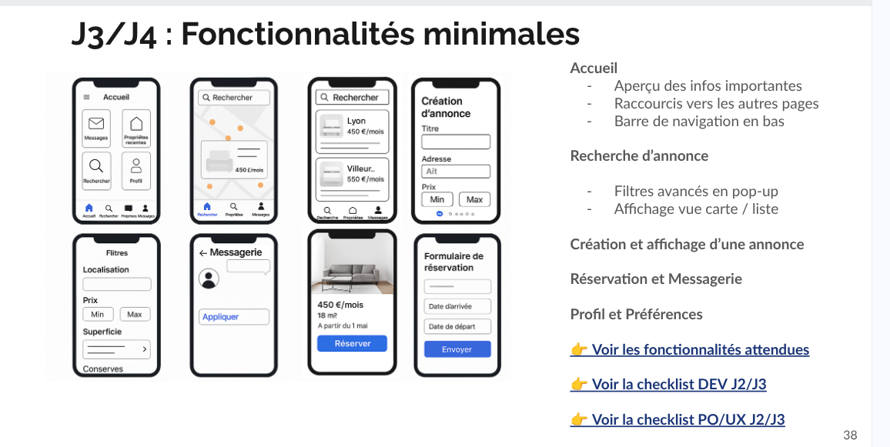

# Projet ART

Marketplace de pratiques artistiques — M2CIM Gestion de Projet 2026/2027.

## Concept

- Des groupes se forment sur la base de leur discipline artistique (musique, danse, théâtre, art…)
- Un organisateur (amateur, artiste, professionnel…) détermine le lieu, le contenu, la fréquence de la session et les frais d'organisation
- Les intéressés peuvent s'inscrire par session
- Le premier contact a lieu par messagerie entre intéressés
- Des annonceurs font la publicité pour des événements, des équipements…



## Fonctionnalités attendues

Application :
- Inscription
- Recherche d'une annonce
- Création / Édition d'une annonce
- Messagerie / Réservation
- Accueil / État de disponibilité
- Carte et géolocalisation
- Profil d'utilisateur et préférences
- Annonce / Réservation
- Vérification / signature (Front)

Site vitrine : voir [landing/README.md](landing/README.md)

## Équipe

| Rôle | Nom | GitHub |
|------|-----|--------|
| PO   |     |        |
| UX   |     |        |
| DEV  |     |        |

## Structure du dépôt

| Répertoire | Contenu |
|------------|---------|
| `/landing` | Site vitrine statique (index.html, css, img) |
| `/frontend` | Application Vue 3 + TypeScript + Shadcn-Vue |
| `/public` | Ancien POC HTML et configurations publiques Firebase/Places |
| `/workers` | Logique métier backend (Cloudflare Workers) |
| `/docs`    | Documentation technique et guides |
| `/design`  | Artefacts UX en HTML (wireframes, maquettes, charte graphique) |
| `/specs`   | Artefacts PO en markdown (spécifications OpenAPI, diagrammes Mermaid, données JSON) |
| `/tests`   | Tests automatisés Playwright (scripts, résultats) |
| `/scripts` | Génération du jeu de démonstration, chargement Firestore, illustrations |
| `agents.md`| Instructions générales pour l'IA |

## Stack technique

- **Front** : Vue 3 + TypeScript + Vite, Tailwind CSS 4 et Shadcn-Vue ; Google Places API (suggestions d’adresse), LeafletJS + OpenStreetMap (cartes), Open-Meteo (météo). PWA prévue ultérieurement.
- **Back** : Firebase Auth (lien e-mail) et Cloud Firestore (profils, activités, messages). Cloudflare Workers, D1, R2 et Realtime Database restent des briques de l’architecture cible, non utilisées par le front actuel.
- **Hébergement** : Firebase Hosting (site vitrine + app)
- **Tests** : Playwright (E2E)

Voir [Stack technique](docs/stack-technique.md) pour le détail.

## Démarrage

```bash
npm install
npm ci --prefix frontend
npm run dev
```

Voir [agents.md](agents.md) pour les instructions destinées aux assistants IA travaillant sur ce dépôt.

Le front Vue et ses tests sont décrits dans [frontend/README.md](frontend/README.md).
