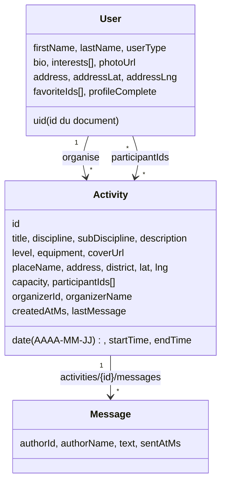

# Données NOVART : modèle Firestore, jeu de démonstration et mise en ligne

## Modèle



Les listes métier sont dans `frontend/src/data/` : `catalog.json` (12 disciplines × 5 sous-disciplines, 4 niveaux, 12 types de lieux, 12 modèles d'activités) et `venues.json` (127 lieux de la Métropole de Lyon, coordonnées approximatives, générés par le script ci-dessous).

## Jeu de démonstration

`scripts/seed/generate-data.mjs` produit, de façon reproductible pour une date donnée :

| Données | Volume |
| --- | --- |
| Membres de démonstration | 120 |
| Activités (de J-30 à J+60) | 220, dont environ 140 à venir |
| Participations (réservations) | environ 1 400 |
| Conversations de groupe / messages | 220 / environ 970 |
| Lieux suggérés | 127 |
| Illustrations de couverture | 24 (`frontend/public/images/activities/`, `scripts/design/generate-covers.mjs`) |

Un instantané est versionné dans `specs/data/` (`node scripts/seed/generate-data.mjs` pour le régénérer).
Tous les documents créés portent `demo: true` ; leurs identifiants commencent par `demo-`. Les membres de démonstration n'ont pas de compte d'authentification.

Les avis (notation) ne sont pas générés : la fonctionnalité n'est pas dans le scénario minimal.

## Mise en ligne (à faire par l'équipe)

1. **Publier les règles** (sinon la lecture des activités renvoie « permission refusée ») :
   ```bash
   npx --yes --package firebase-tools firebase deploy --only firestore:rules --project novart-109bf
   ```
2. **Charger les données** avec une clé de compte de service (console Firebase › Paramètres du projet › Comptes de service › Générer une nouvelle clé privée), gardée hors du dépôt :
   ```bash
   cd scripts/seed
   npm install
   GOOGLE_APPLICATION_CREDENTIALS=/chemin/vers/cle.json npm run seed
   ```
   Relancer avec `npm run reseed` la veille d'une démonstration : les documents `demo: true` sont supprimés puis recréés avec des dates recalées sur le jour même. Les activités et comptes réels ne sont pas touchés.
3. **Publier l'application** comme avant : `npx --yes --package firebase-tools firebase deploy --only hosting:app --project novart-109bf`.

## Services tiers utilisés par le front

| Service | Usage | Clé |
| --- | --- | --- |
| Google Places API (New) | Suggestions d'adresse (profil, lieu d'activité) | `public/places-config.js` |
| Open-Meteo | Météo du jour de l'activité (fiche) | aucune |
| OpenStreetMap | Fond des cartes Leaflet | aucune |
