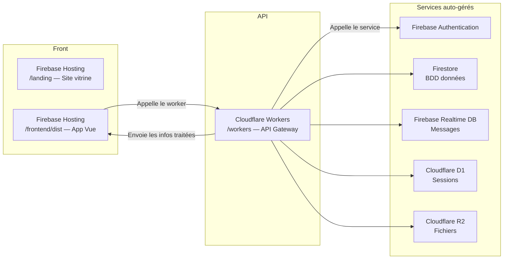

# Stack technique — Architecture serverless

Le schéma ci-dessous décrit l’architecture cible. **En service aujourd’hui** : le front Vue appelle directement Firebase Auth, Firestore et Google Places ; le Worker Cloudflare envoie l’e-mail de connexion NOVART (lien Firebase généré avec le compte de service, envoi Brevo, anti-abus dans D1 ; voir `workers/README.md`). Pas encore utilisés : Realtime DB (la messagerie passe par Firestore) et R2 (envoi de photos à venir).

## Composants

| Couche | Techno | Rôle |
|--------|--------|------|
| Front End | Vue 3, TypeScript, Vite, Tailwind CSS 4, Shadcn-Vue | Interface responsive ; PWA installable à venir |
| Carte | LeafletJS + OpenStreetMap | Carte des activités et de la communauté |
| Géolocalisation | Google Places API | Autocomplete adresse + geocoding |
| Interface REST API | Cloudflare Workers | `POST /auth/email-link` : e-mail de connexion NOVART ; point d'entrée des futurs services |
| E-mails | Brevo (API transactionnelle) | E-mail de connexion aux couleurs de NOVART, envoyé par le Worker |
| Authentification | Firebase Auth | Connexion sans mot de passe (lien magique) ou Google |
| BDD Données | Firestore (NoSQL) | Profils, activités, inscriptions, liste d'attente, messagerie de groupe et privée |
| BDD Messages | Firebase Realtime DB | Non utilisée (messagerie dans Firestore) |
| Anti-abus | Cloudflare D1 (SQL) | Limite des demandes de lien de connexion (empreintes, 24 h) ; les sessions sont gérées par Firebase Auth |
| Fichiers | Cloudflare R2 | Prévu pour les photos (binding désactivé tant qu'il n'est pas utilisé) |
| Hébergement | Firebase Hosting | Site vitrine + application |

## Sécurité

- Les identifiants de service Firebase sont stockés dans les secrets du Worker, jamais commités
  ni exposés côté front.
- L'accès au Worker est restreint par nom de domaine (CORS et contrôle de l'origine), le lien de connexion ne peut ramener que vers l'appli, et les demandes sont limitées par adresse et par appareil (D1).
- Si le Worker est indisponible, l'appli envoie l'e-mail standard de Firebase : la connexion ne dépend pas du Worker.

## Déploiement

- Front Vue : `npm run build` produit `frontend/dist`. Firebase Hosting cible ce dossier et reconstruit automatiquement avant publication.
- Application : `firebase deploy --only hosting:app` ; site vitrine : `firebase deploy --only hosting:landing`.
- Back (`/workers`) : `npm run worker:migrate` puis `npm run deploy:worker` (secrets et mise en service : `workers/README.md`)
