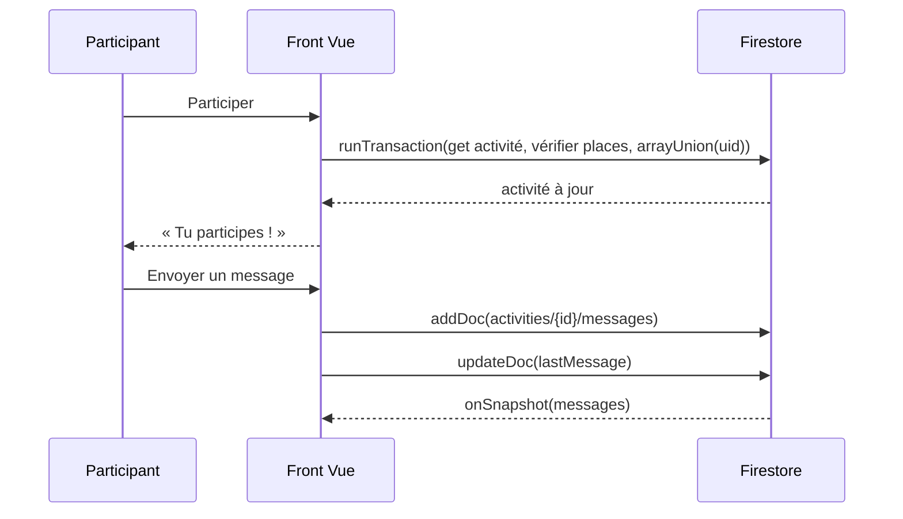
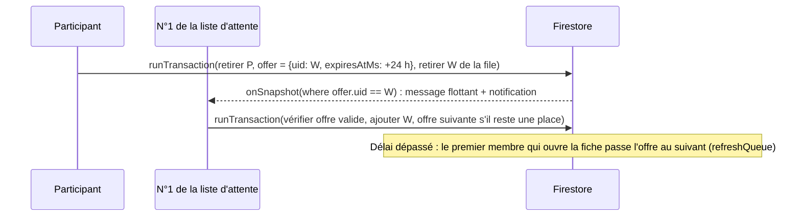

# EPIC E5 et E6 : Participation et conversations

Backlog original : US-09 à US-12 (MUST). Maquettes : 11, 14, 15, 17.

## US-09 — S'inscrire à une activité

| # | Critère d'acceptation | Test |
|---|---|---|
| CA1 | Bouton « Participer » sur la fiche d'une activité à venir et non complète | `scenario.spec.ts` |
| CA2 | Inscription dans une transaction Firestore : jamais au-delà de la capacité ; message « Trop tard, la dernière place vient d'être prise » | `services/activities.ts` |
| CA3 | Écran « Tu participes ! » : récapitulatif, organisation, accès au groupe, rappel `.ics`, partage, « Voir toutes mes activités » | `scenario.spec.ts` |
| CA4 | Activité complète : bouton « Complet » désactivé ; activité terminée : « Activité terminée » | `scenario.spec.ts` US-09/10 |

## US-10 — Gérer sa participation

| # | Critère d'acceptation | Test |
|---|---|---|
| CA1 | « Quitter l'activité » avec confirmation ; la place est libérée | `scenario.spec.ts` |
| CA2 | « Mes activités » : onglets À venir / Passées, sections « J'y participe », « J'organise » et « En liste d'attente » | captures |
| CA3 | Si des personnes attendent, la place libérée est proposée à la première de la liste | `activity.test.ts` |

## Liste d'attente (sujet ART : « notifié en cas de désistement, doit confirmer »)

| # | Critère d'acceptation | Test |
|---|---|---|
| CA1 | Activité complète : « Rejoindre la liste d'attente » ; la fiche affiche « Tu es n°X » et le nombre de personnes en attente | `scenario.spec.ts` |
| CA2 | « Quitter la liste d'attente » à tout moment | idem |
| CA3 | Désistement : la place est proposée au n°1, réservée 24 h (jamais au-delà du début de l'activité, jamais moins d'1 h) | `activity.test.ts` |
| CA4 | La personne est prévenue en temps réel (message flottant, pastille sur la cloche, écran Notifications) | `scenario.spec.ts` |
| CA5 | « Confirmer ma place » l'inscrit ; « Je laisse ma place » (avec confirmation) passe la place au suivant | idem, `activity.test.ts` |
| CA6 | Délai dépassé : la place passe au suivant dès qu'un membre ouvre la fiche (pas de serveur) | `activity.test.ts` |
| CA7 | Tant que des personnes attendent, personne ne peut passer devant en s'inscrivant directement | idem, `docs/firestore.rules` |

## Notifications (maquette 13)

Écran `#/notifications` (cloche sur Découvrir, ligne « Notifications » dans Profil), onglets Toutes / Activités / Messages :
place libérée à confirmer, rang en liste d'attente, rappel des activités qui commencent dans les 48 h, nouveaux messages des groupes (7 derniers jours).
Les notifications vues sont mémorisées sur l'appareil. Pas de notification push (il faudrait Cloud Functions et Firebase Cloud Messaging).

## US-11 / US-12 — Groupe de l'activité

| # | Critère d'acceptation | Test |
|---|---|---|
| CA1 | Liste des conversations (activités où je participe ou que j'organise), onglets Actives / Archivées, recherche, dernier message | `scenario.spec.ts` |
| CA2 | Groupe en temps réel (`onSnapshot`), séparateurs par jour, mes messages à droite | idem |
| CA3 | Envoi d'un message (1000 caractères max) ; le dernier message alimente la liste | idem |
| CA4 | Non-membre : « Groupe réservé aux participants » ; les règles Firestore refusent la lecture | `docs/firestore.rules` |

## Contact : messagerie privée (sujet ART : « contacter l'organisateur avant de réserver »)

| # | Critère d'acceptation | Test |
|---|---|---|
| CA1 | Fiche activité : « Contacter <prénom> » ouvre une conversation privée avec l'organisateur, sans être inscrit | `scenario.spec.ts` |
| CA2 | Bouton « Écrire » sur chaque participant de la fiche et sur chaque membre de la communauté | idem |
| CA3 | Une seule conversation par paire de membres ; l'activité d'origine est rappelée (« À propos de… ») | idem |
| CA4 | Conversations : onglets Groupes / Privées / Archivés ; non-lus signalés (point, pastille sur l'onglet de navigation, Notifications) | idem |
| CA5 | Seuls les deux membres lisent et écrivent ; chacun ne met à jour que sa propre lecture | `docs/firestore.rules` |
| CA6 | Mention à l'écran : « seuls X et toi pouvez la lire » ; politique de confidentialité : pas de chiffrement de bout en bout | landing `legal.html` |

## Spécifications techniques

Les transitions de la file sont des fonctions pures (`frontend/src/lib/waitlist.ts`), testées unitairement et appliquées dans une transaction ;
les règles Firestore (`queueUpdate`) n'autorisent que ces transitions (chacun ne s'ajoute ou ne se retire que lui-même, l'offre va toujours au premier de la file).
Limite connue : sans Cloud Functions, l'expiration n'est traitée qu'à l'ouverture de la fiche par un membre.

Choix : la messagerie utilise Firestore (sous-collection) plutôt que Realtime Database, déjà verrouillée et non nécessaire pour ce volume.

## Exclusions

- Pièces jointes, réactions, notifications push.
- Blocage et signalement d'un membre en messagerie privée (à prévoir avant une ouverture au public).
