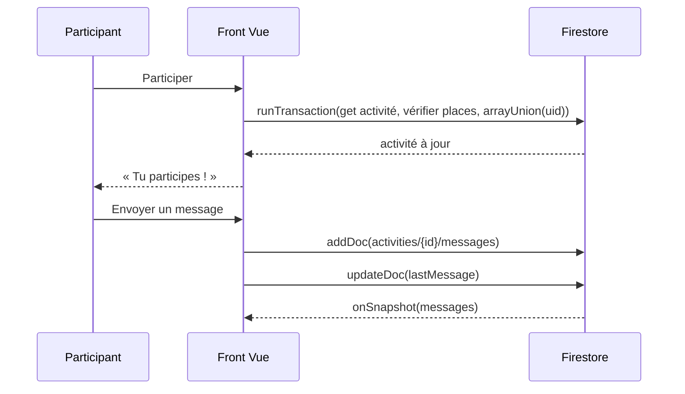

# EPIC E5 et E6 : Participation et conversations

Backlog original : US-09 à US-12 (MUST). Maquettes : 11, 14, 15, 17.

## US-09 — S'inscrire à une activité

| # | Critère d'acceptation | Test |
|---|---|---|
| CA1 | Bouton « Participer » sur la fiche d'une activité à venir et non complète | `scenario.spec.ts` |
| CA2 | Inscription dans une transaction Firestore : jamais au-delà de la capacité ; message « Trop tard, la dernière place vient d'être prise » | `services/activities.ts` |
| CA3 | Écran « Tu participes ! » : récapitulatif, organisation, accès au groupe, rappel `.ics`, partage, « Voir toutes mes activités » | `scenario.spec.ts` |
| CA4 | Activité complète : bouton « Complet » désactivé ; activité terminée : « Activité terminée » | `scenario.spec.ts` US-09/10 |

## US-10 — Gérer sa participation

| # | Critère d'acceptation | Test |
|---|---|---|
| CA1 | « Quitter l'activité » avec confirmation ; la place est libérée | `scenario.spec.ts` |
| CA2 | « Mes activités » : onglets À venir / Passées, sections « J'y participe » et « J'organise » | captures |

## US-11 / US-12 — Groupe de l'activité

| # | Critère d'acceptation | Test |
|---|---|---|
| CA1 | Liste des conversations (activités où je participe ou que j'organise), onglets Actives / Archivées, recherche, dernier message | `scenario.spec.ts` |
| CA2 | Groupe en temps réel (`onSnapshot`), séparateurs par jour, mes messages à droite | idem |
| CA3 | Envoi d'un message (1000 caractères max) ; le dernier message alimente la liste | idem |
| CA4 | Non-membre : « Groupe réservé aux participants » ; les règles Firestore refusent la lecture | `docs/firestore.rules` |

## Spécifications techniques

Choix : la messagerie utilise Firestore (sous-collection) plutôt que Realtime Database, déjà verrouillée et non nécessaire pour ce volume.

## Exclusions

- Pièces jointes, réactions, messages privés, notifications push, non-lus.
- Liste d'attente avec confirmation en cas de désistement : à arbitrer par l'équipe.
