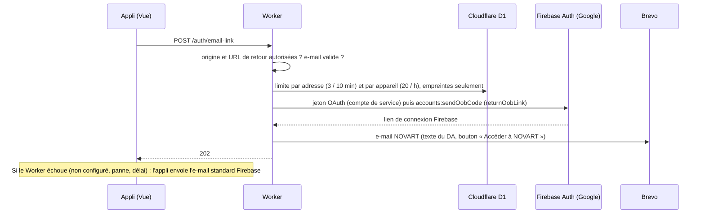

# API NOVART (Cloudflare Worker)

| Route | Rôle |
| --- | --- |
| `GET /health` | Vérifier que le Worker répond |
| `POST /auth/email-link` `{ email, continueUrl }` | Envoyer l'e-mail de connexion NOVART |
| `POST /uploads/cover` (corps : l'image, `Authorization: Bearer <jeton Firebase>`) | Photo de couverture d'une activité, stockée dans R2 ; renvoie `{ url }` |
| `GET /files/covers/…` | Lecture publique d'une photo (cache navigateur d'un an) |

**Photos (R2)** : seuls les membres connectés peuvent envoyer (jeton Firebase vérifié avec les clés publiques de Google : signature, projet, expiration) ; l'appli recadre et réduit l'image (16:10, 1600 × 1000 px, WebP) ; le Worker revérifie le type réel du fichier (JPEG, PNG ou WebP), la taille (2 Mo max) et limite à 30 envois par heure et par membre (D1, empreinte de l'uid). Les photos remplacées ne sont pas encore supprimées de R2.



Le lien est le même que celui que Firebase enverrait : le clic ramène sur `/login.html` et l'appli termine la connexion comme avant. Seul l'e-mail change.

**Sécurité et RGPD** : appels acceptés uniquement depuis l'appli (`ALLOWED_ORIGINS`) ; le lien ne peut ramener que vers l'appli (pas de redirection ouverte) ; D1 ne stocke que des empreintes SHA-256 salées (ni e-mail, ni IP), effacées après 24 h ; aucune adresse dans les journaux ; clés en secrets Cloudflare, jamais dans le dépôt.

Tests (sans réseau ni compte) : `npm run test:worker` à la racine du dépôt.

## Mise en service (une fois, environ 20 minutes)

Toutes les commandes se lancent **à la racine du dépôt**, dans WSL, après `npm ci`.

### 1. Brevo (envoi des e-mails)

1. Créer un compte gratuit sur [brevo.com](https://www.brevo.com) (300 e-mails par jour).
2. **Expéditeurs** : *Senders, Domains & Dedicated IPs > Senders > Add a sender*, nom `NOVART`, avec l'adresse de l'équipe qui enverra les liens, puis la valider avec le code reçu.
3. **Clé d'API** : *SMTP & API > API Keys > Generate a new API key*. La copier (commence par `xkeysib-`), elle ne s'affiche qu'une fois.

> Une adresse Gmail ou Outlook comme expéditeur fonctionne, mais l'e-mail peut arriver dans les indésirables. Pour la démo, vérifier ce dossier ; plus tard, un domaine à vous authentifié dans Brevo réglera ce point.

### 2. Clé du compte de service Firebase

Console Firebase > ⚙️ *Paramètres du projet > Comptes de service > Générer une nouvelle clé privée*.
Ranger le fichier JSON **hors du dépôt**, par exemple `~/secrets/novart-firebase.json`. Ne jamais le partager ni le commiter.

### 3. Cloudflare : R2, base D1 et déploiement

R2 (photos) : dans le tableau de bord Cloudflare, *R2 Object Storage* > activer l'offre gratuite (10 Go ; une carte ou PayPal est demandée pour vérification, sans prélèvement sous le quota), puis :

```bash
npx wrangler r2 bucket create art-files
```


```bash
npx wrangler login              # compte Cloudflare qui possède account_id (wrangler.toml)
npx wrangler whoami             # vérifier le compte
npm run worker:migrate          # tables email_requests et upload_requests dans la base D1 art-sessions
npm run deploy:worker           # affiche l'URL : https://projet-art-api.<sous-domaine>.workers.dev
```

Vérifier : ouvrir `https://projet-art-api.<sous-domaine>.workers.dev/health` dans le navigateur, qui doit afficher `{"status":"ok"}`.

### 4. Secrets du Worker

```bash
npx wrangler secret put FIREBASE_SERVICE_ACCOUNT --config workers/wrangler.toml < ~/secrets/novart-firebase.json
npx wrangler secret put BREVO_API_KEY --config workers/wrangler.toml     # coller la clé xkeysib-…
npx wrangler secret put SENDER_EMAIL --config workers/wrangler.toml      # l'adresse validée dans Brevo
```

Chaque `secret put` met le Worker à jour tout de suite.

### 5. Brancher l'appli

Dans `frontend/.env.production`, renseigner l'URL du Worker (sans `/` final) :

```
VITE_AUTH_API_URL=https://projet-art-api.<sous-domaine>.workers.dev
```

Puis publier l'appli : `npx --yes --package firebase-tools firebase deploy --only hosting:app --project novart-109bf`.

### 6. Tester

Demander un lien depuis l'appli en ligne : l'e-mail vient de **NOVART** avec le texte du DA et le bouton « Accéder à NOVART ».
Suivi des envois : Brevo > *Transactional > Logs*. Journaux du Worker en direct : `npx wrangler tail --config workers/wrangler.toml`.

## Dépannage

| Symptôme | Cause probable | Solution |
| --- | --- | --- |
| E-mail standard de Firebase reçu | `VITE_AUTH_API_URL` vide, ou le Worker a échoué (repli prévu) | Vérifier l'URL, puis `wrangler tail` pendant une demande |
| Journal « FIREBASE_SERVICE_ACCOUNT manquant » | Secret absent | Étape 4 |
| Journal « Brevo a refusé l'envoi (401) » | Clé Brevo invalide | Régénérer la clé, refaire `secret put BREVO_API_KEY` |
| Journal « Brevo a refusé l'envoi (400) » | Expéditeur non validé dans Brevo | Valider l'adresse (étape 1.2) ou corriger `SENDER_EMAIL` |
| Journal « lien Firebase refusé (400) » | Domaine de l'appli non autorisé dans Firebase Authentication | Ajouter `novart-app.web.app` aux domaines autorisés |
| `wrangler deploy` : base D1 introuvable | Base absente de ce compte Cloudflare | `npx wrangler d1 create art-sessions`, reporter le `database_id` dans `wrangler.toml` |
| `wrangler deploy` : bucket R2 introuvable | R2 non activé ou bucket absent | Activer R2, puis `npx wrangler r2 bucket create art-files` |
| « Ta session a expiré » à l'envoi d'une photo | Jeton refusé (`FIREBASE_PROJECT_ID` dans `wrangler.toml`) | Vérifier `FIREBASE_PROJECT_ID = "novart-109bf"`, se reconnecter |
| « Tu as demandé plusieurs liens d'affilée » | Limite anti-abus (3 liens en 10 min pour une adresse) | Utiliser le dernier lien reçu ou patienter |

## Développement local

`workers/.dev.vars` (jamais commité) avec `FIREBASE_SERVICE_ACCOUNT`, `BREVO_API_KEY`, `SENDER_EMAIL`, puis `npm run worker:dev` et, dans `frontend/.env.local`, `VITE_AUTH_API_URL=http://localhost:8787`.
